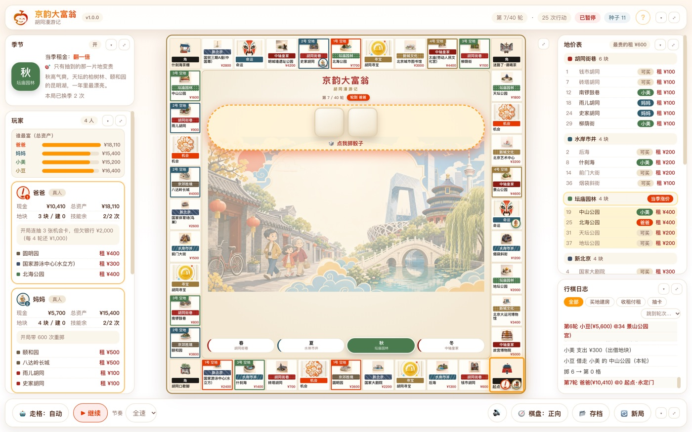
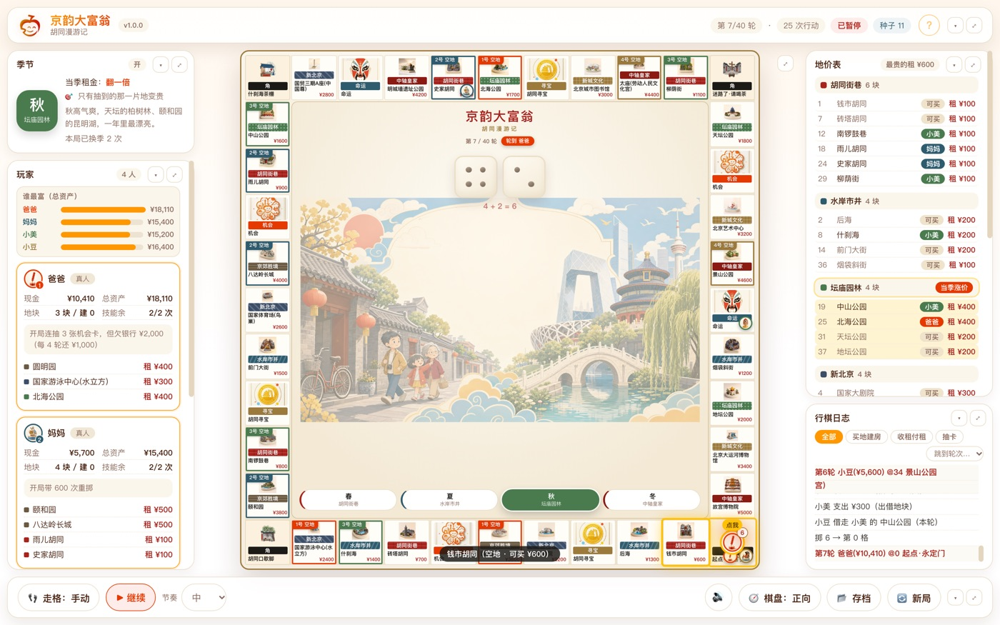
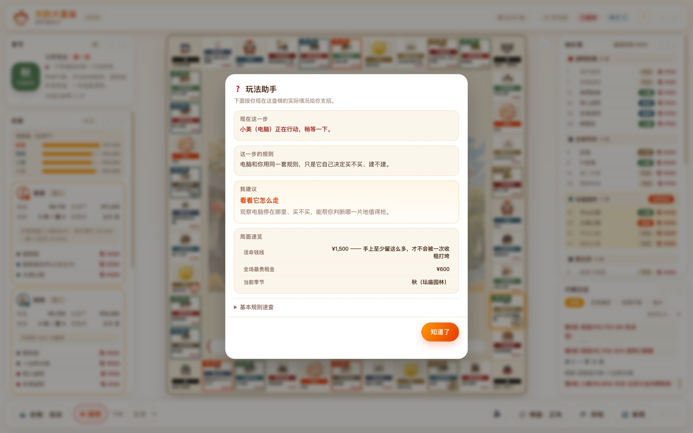
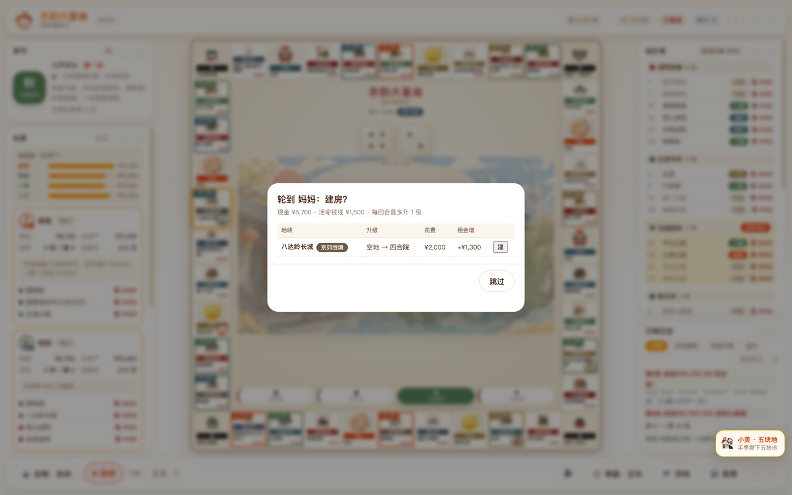
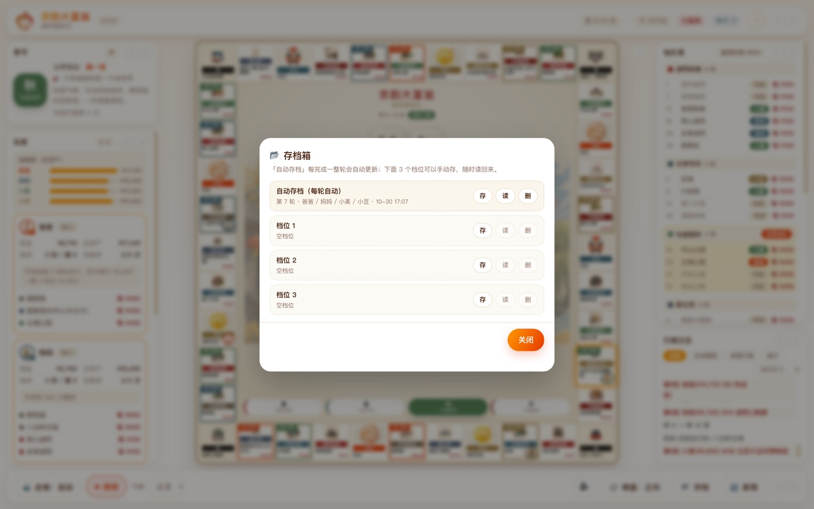

# 京韵大富翁 · 胡同漫游记

儿童城市探索桌游《京韵大富翁 · 胡同漫游记》的数字版。**打开就能和小朋友一起玩**：
在 11×11 的京城棋盘上掷骰子、逛胡同、买地建房、收租、换季、翻牌寻宝，
一路把北京的地标与胡同收进自己的「产业」。



- 支持 **2 / 3 / 4 人**对局，每个座位可独立选择 **真人手动** 或 **电脑自动** —— 一个人可以和三个电脑玩，全家也能围在同一台设备上玩。
- 操作完全仿真线下桌游：点棋盘中间的骰子、点棋子逐格走、点卡摞翻牌，没有「下一步」按钮。
- 内置「玩法助手」，随时按当前棋局讲规则、给建议；第一次打开还有五张图卡引导。
- 当前版本 **v1.0.0**。

## 提供两个版本

| 版本 | 适合场景 | 特点 |
| --- | --- | --- |
| **Web 版** | 电脑 / 平板 / 一体机的浏览器 | 随开随玩，一个静态目录即可部署 |
| **安卓版** | 安卓平板 / 触屏一体机 | 安装包内置全部素材，**完全离线**；横屏铺满，适合展台体验 |

安卓版横屏铺满触屏一体机，手机上竖屏也能正常玩：


## 快速开始

### Web 版

纯静态页面，把 `public/` 目录交给任意静态服务器托管即可，例如：

```bash
python3 -m http.server 8099 --directory public
```

浏览器打开 http://localhost:8099/ 就能玩。
注意要经 HTTP 访问：直接双击 `index.html` 会因为浏览器的安全限制读不到素材。

### 安卓版

安装安卓安装包（APK）后点图标打开即可，无需联网。

## 开始一局

第一次打开会先弹五张图卡讲怎么玩：


之后进入开局设置：


| 设置项 | 说明 |
| --- | --- |
| 人数 | 2 / 3 / 4 人 |
| 谁是谁 | 每个座位可填称呼（可留空）；勾选 = **真人手动**（自己掷骰、点棋子走），不勾 = **电脑自动** |
| 随机种子 | 留空 = 每局都不一样；填同一个数字 = 得到完全一样的一盘棋，方便公平对战或复盘 |
| 可选开关 | 季节机制、胡同寻宝、胡同通·多抽、建房须集齐分区、技能不限次、音效 |
| 高级设置 | 换季后哪里的房租变贵 / 涨多少；翻牌是「我自己关」还是「到点自己关」（3 / 6 / 9 / 15 秒） |

> 玩着忘了规则？随时点右上角的「?」打开**玩法助手**，它按当前这盘棋的实际情况讲规则、给下一步建议。

## 怎么操作

三种动作都靠**直接点桌面上的实物**触发，和真人围桌玩一个手感：

| 点这里 | 会发生什么 |
| --- | --- |
| 棋盘中间的**骰子盘** | 两枚骰子翻滚后定格，报出「a + b = 步数」 |
| 棋盘上的**棋子**，或它要去的**下一格** | 棋子往下一格跳一次，头顶剩余步数 −1 |
| 亮起的**机会卡 / 命运卡 / 寻宝卡 / 季节卡** | 翻开一张，翻完自动收摊 |

手动走格时，棋子上方会浮一条「下一格」小提示 —— 下一格是什么、谁的、要付多少租、能不能买，先想再点：



停在卡牌格会翻出一张卡，效果当场结算：


骰子只在「轮到你、且上一动作收干净」时亮起；电脑回合、动画播放中、走格没走完时点不动。
电脑的掷骰、走格、买地、建房、翻卡全部自己完成，不会弹窗等人点。

控制条上可以随时切换：

- **走格：手动 / 自动** —— 手动＝逐格点棋子（默认，仿真推着棋子走）；自动＝按节奏自己跳完。
- **暂停 / 继续** —— 暂停后所有自动推进冻结，方便慢慢看电脑怎么走。
- **速度** —— 全速 / 快 / 中（默认）/ 慢；只有慢速才看得到动画。
- **棋盘朝向** —— 「正向」全部可读，「纸样」按印刷方向旋转。
- **音效** —— 一键开关。声音是实时合成的，不带音频素材、不增体积。
- **存档** —— 每完成一整轮自动存档，另有 3 个手动档位可随时存、读、删。
- **新局** —— 回到开局设置，重新选人数、称呼和玩法。

每个区域（顶栏 / 控制条 / 季节 / 玩家 / 行情 / 日志）右上角都有两颗小按钮：
`▾` 收起、`⤢` 全屏 —— 可以把棋盘或日志单独放大来看。

接键盘也能玩：空格 / 回车 = 该掷骰就掷骰、该走格就走一格，`?` = 玩法助手，`P` = 暂停 / 继续。

点右上角的「?」打开**玩法助手**：它读当前棋局，告诉你现在该做什么、涉及什么规则、建议怎么走：



## 规则速览

- **怎么走**：两枚骰子点数相加 = 走的格数；绕一圈经过起点领 ¥1500。
- **怎么赢**：走满 40 轮后，总资产（现金 + 地产价值）最多的人获胜；中途破产出局。
- **买地**：停在没有主人的地上，可以花钱买下来；别人停上去就要付你租金。
- **建房**：第一轮只能占空地，不盖房；从第二轮起，**只有又走回自己已经买下的那块地**才能升一级（空地 → 四合院 → 城楼）。



- **季节**：棋子每次经过起点抽 1 张季节卡 —— 立刻换季，当季那一片的地租金变贵，卡上的小效果（领钱 / 前进 / 免租…）当场生效。
- **身份技能**：开局每人抽一张身份卡，有各自的小技能，整局最多用 2 次。
- **现金永不为负**：付不起时会先自动变卖资产（拆建筑 / 抵押）补齐，卖光仍不够就只扣到 0 —— 家庭版不引入「负债」。
- 面板上会提示一条「活命钱线」：建议手上至少留一笔钱（约等于最贵的一次租金），不至于被一次收租打垮。

## 加料开关（开局面板可逐条开关）

| 开关 | 默认 | 效果 |
| --- | --- | --- |
| 季节机制 | 开 | 过起点抽季节卡 → 换季，当季分区的租金变贵 |
| 胡同寻宝 | 开 | 停在寻宝格时，按持有胡同地块数多抽寻宝卡 |
| 胡同通·多抽 | 关 | 每持 2 块胡同地，寻宝格再多抽 1 张 |
| 建房须集齐分区 | 关 | 经典规则；关 = 有钱就能升 |
| 技能不限次 | 关 | 关 = 身份卡技能整局限 2 次 |

## 给孩子玩的设计

- **掷骰跳动 / 玩偶逐格跳 / 落格脉冲** —— 骰子先在桌上翻滚再定格；小玩偶顶着京味棋子一格一格跳，头顶数字实时倒数。
- **回合气泡** —— 轮到真人时提示「点棋盘中间的骰子走一走」，电脑回合提示「它自己走，不用你点」。
- **下一格预告** —— 手动走格时浮一条小提示：下一格是什么、谁的、要付多少租、能不能买，让孩子先想再点。
- **成就徽章** —— 第一块地 / 第一次收租 / 盖起四合院 / 第一次换季 / 反超领先等节点，右下角即时冒一枚小徽章。
- **谁最富领先条** —— 玩家面板把「总资产」画成横条，谁最长谁最富；现金一变就飘 `+¥ / -¥`。
- **日志可以筛** —— 上方切「全部 / 买地建房 / 收租付租 / 抽卡」，右侧下拉直接跳到第 N 轮，每轮第一行吸在顶部。
- **京味棋子** —— 四位玩家分别是糖葫芦、鸽哨、脸谱、黄包车。
- **跟随系统「减少动态效果」** —— 系统开了这项时，动画自动降级为瞬变。
- **闲置演示** —— 开局设置页停着没人动，会自动放一场电脑对电脑的演示局循环播放；碰一下屏幕立刻回到设置页，适合摆在展台、摊位。

## 存档与设置



- **存档**：只在整轮边界自动写（一轮没跑完不给存，避免读档丢半轮），另可手动存 3 个命名档位。
  存档保存在设备本地：Web 版在浏览器里（清缓存即丢），安卓版额外镜像到应用私有目录（清缓存也不丢）。**不上传任何服务器。**
- **设置记忆**：人数、称呼、真人 / 电脑、加料开关、速度、朝向、音效等下次开局自动带出。
  随机种子有意不记忆，保证「留空 = 每局不同」。

## 开发者

- `public/` 就是部署产物：`src/core/` 是零依赖的规则内核（浏览器 / Node 可共用），`src/ui/` 是界面层，`assets/` 是数据与素材。
- `android/` 是安卓壳工程；`tests/` 是内核回归与同种子对拍；`tools/` 是素材同步、构建与验收脚本。
- 本仓只保留代码与运行工具；设计与技术文档另行归档，不在本仓。

## 版权与品牌声明

当前七笑果的所有素材和品牌标识，版权均归北京七笑果文化体育有限公司所有，侵权必究。
